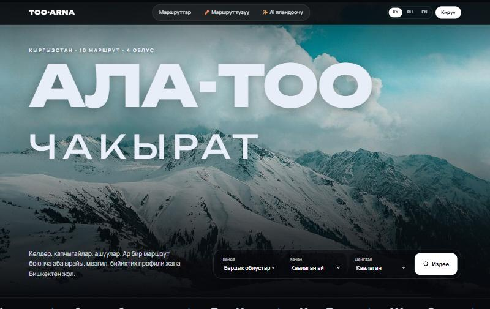
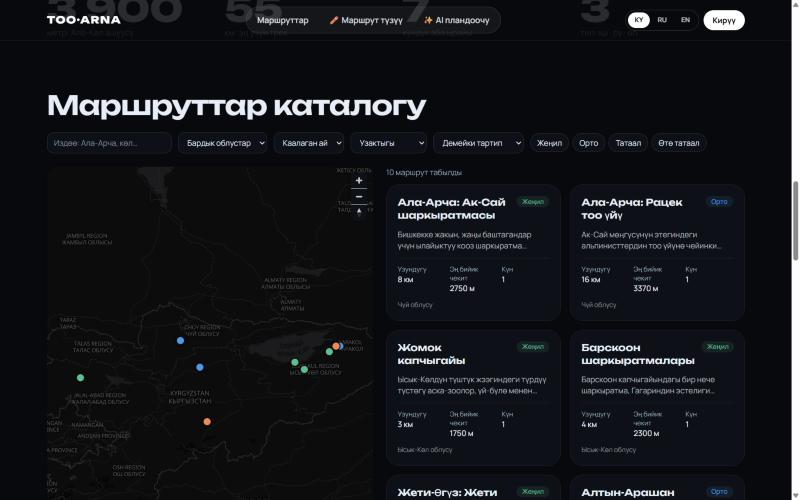
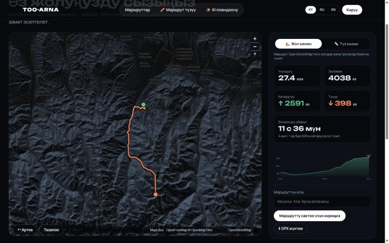
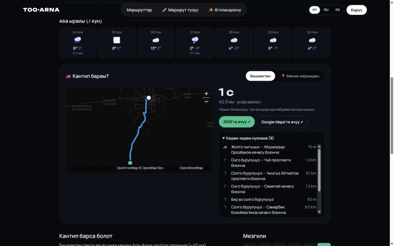

# ⛰️ Too Arna — Hiking Trails of Kyrgyzstan

**English** · [Кыргызча](README.md)

A full-stack platform for hiking in Kyrgyzstan: an interactive trail catalog with maps, weather and reviews, a **route builder** that snaps to real mountain trails, **driving directions** to every trailhead, offline mode for the mountains, and an **AI trip planner** that only recommends trails that exist in the database.



**Stack:** Python · Django 5 · GeoDjango · Django Ninja · PostgreSQL + PostGIS · Next.js 16 (App Router, Server Actions) · React 19 · MapLibre GL · Tailwind 4 · PWA · Docker · GitHub Actions

## Features

| | |
|---|---|
| 🗺️ **Catalog & map** | Filters by region, difficulty, month and length, sorting by rating, "near me" search (PostGIS `dwithin` + `Distance`) |
| ✏️ **Route builder** | Click the map to draw a route. In **follow-trails** mode every leg is routed along OpenStreetMap paths with [BRouter](https://brouter.de) (`hiking-mountain` profile); legs with no trail nearby fall back to a straight line and the UI says so. Distance, ascent/descent (with DEM noise smoothing), walking time and an elevation profile update live. Export to GPX, save to your account |
| 🚗 **Getting there** | Car route from Bishkek or from the user's location to the trailhead via [OSRM](https://project-osrm.org): map, distance, drive time, turn-by-turn steps in 3 languages, and one-tap **Open in 2GIS / Google Maps** for real navigation |
| ✨ **AI planner** | A tool-calling LLM agent (`search_trails`, `get_trail_details`, `get_weather_forecast`) that plans trips from the **real database only** and never invents trails. Works with any OpenAI-compatible API (Groq, Gemini, Ollama…) |
| 📈 **GPX** | All 10 trails ship with a track and elevation profile: the `build_tracks` command routes each trail's waypoints along OSM paths with BRouter and writes GPX fixtures that `seed_trails` loads. You can also upload a GPX file in the admin or via API: route, distance, elevation gain (hysteresis filter) and elevation profile are computed automatically |
| 🌦️ **Weather** | 7-day Open-Meteo forecast for each trailhead, cached |
| ⭐ **Community** | Sign-up / login (bearer token in an httpOnly cookie), reviews (one per user), favorites |
| 🌗 **Two themes** | Dark ("cinema") and light, switched instantly with one button and remembered in a cookie (rendered on the server, so no flash). Maps switch style too |
| 🌐 **3 languages** | Kyrgyz, Russian, English for both UI and trail content |
| 📴 **Offline (PWA)** | A service worker caches a trail page and the surrounding map tiles (z8–14), because there is no signal in the mountains |

## Screenshots

| | |
|---|---|
|  |  |
| **Catalog:** filters, dark map, trail cards | **Route builder:** a route following the trail up the Ala-Archa gorge |
|  |  |
| **Getting there:** car route from Bishkek with turn-by-turn steps | **AI planner:** a plan built only from trails in the database |

## Run it

```bash
cp .env.example .env      # set LLM_API_KEY for the AI planner (Groq and Gemini have free tiers)
docker compose up --build
```

- Site: http://localhost:3000
- API docs (Swagger): http://localhost:8000/api/docs
- Admin: http://localhost:8000/admin (`docker compose exec backend python manage.py createsuperuser`)

On every start the backend runs migrations and seeds 10 trails.

## Tests

```bash
docker compose exec backend pytest        # API, auth, reviews, GPX, AI agent, route builder, directions
cd frontend && npx tsc --noEmit && npm run build
```

External services (LLM, Open-Meteo, BRouter, OSRM) are mocked in tests. CI runs both suites against PostGIS on every push.

## API

| Method | Path | |
|---|---|---|
| GET | `/api/trails` | `q, region, difficulty[], max_distance_km, max_days, month, lat, lng, radius_km, sort, lang` |
| GET | `/api/trails/{slug}` | Full details, route and elevation profile |
| GET | `/api/trails/{slug}/weather` | 7-day forecast |
| GET | `/api/trails/{slug}/directions` | Driving route: `from_lat, from_lng` (default: Bishkek) |
| POST | `/api/routes/analyze` | Route builder: `{points: [[lng, lat]…], follow_trails}` → distance, ascent, time, profile, path |
| GET/POST | `/api/me/routes` | Saved routes (DELETE `/api/me/routes/{id}`) |
| GET/POST | `/api/trails/{slug}/reviews` | Reviews (POST again to update) |
| POST | `/api/trails/{slug}/favorite` | Toggle favorite |
| POST | `/api/planner` | AI plan `{prompt, lang}` (15 requests per hour per IP) |
| POST | `/api/auth/register` · `/login` · `/logout`, GET `/me` | Bearer token |

## Design decisions

- **All API calls happen on the server** (Server Components / Actions). The token lives in an httpOnly cookie that browser JavaScript never sees.
- **The AI cannot hallucinate trails:** the agent only gets data through tools, and the response returns just the trails it actually cited as `trail_slugs`.
- **Being frugal with free APIs:** Open-Meteo rate-limits elevation lookups per coordinate, so elevations are cached per point and BRouter legs per segment. Adding a waypoint only fetches the new leg.
- **Turn-by-turn steps are returned as data** (`type`, `modifier`, street name) and worded on the frontend in the user's language.
- **Ratings are computed with a subquery** (not a JOIN), so text search does not skew the average.
- **GPX and route maths are plain Python**, decoupled from Django and tested without a database.

## Deploy (free)

Database on **Neon** (free plan never expires, PostGIS included), backend on **Render** (`render.yaml` Blueprint, Docker, health check at `/api/health` that never touches the DB), frontend on **Vercel** (root directory `frontend`, region `fra1`, `API_URL` = the Render URL). Set the repository variable `BACKEND_URL` to let `keepalive.yml` stop Render's free instance from sleeping.

## Data note

Seed coordinates, distances and elevations are **approximate**. Verify each trail against a real GPX track before publishing.

---
Map: [OpenFreeMap](https://openfreemap.org) · © OpenStreetMap contributors · Terrain: Mapzen Terrain Tiles (AWS Open Data) · Weather & elevation: [Open-Meteo](https://open-meteo.com) · Trails: [BRouter](https://brouter.de) · Driving: [OSRM](https://project-osrm.org) / FOSSGIS · Photos: [Unsplash](https://unsplash.com) (Amir Asake, Ilya Yudin, Denis Volkov, Bakhtiyar Ibragimov)
