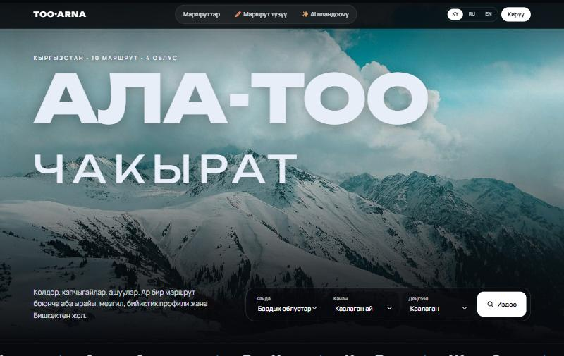
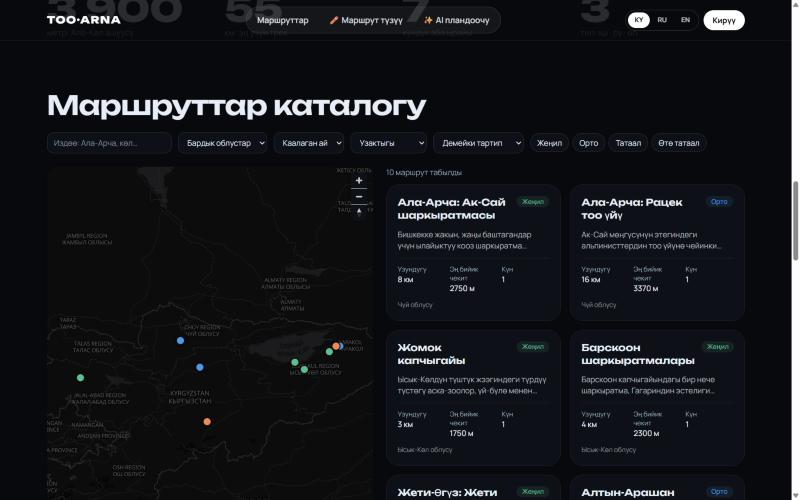
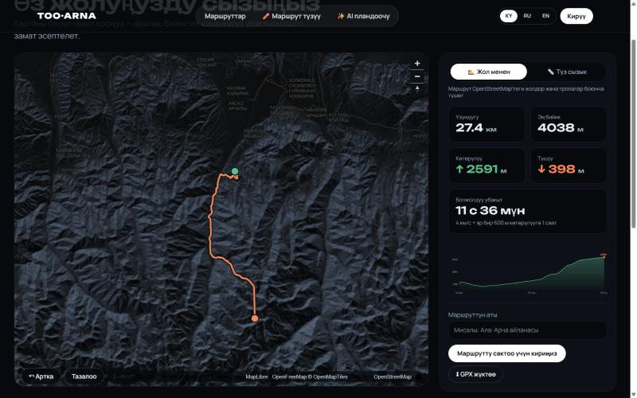
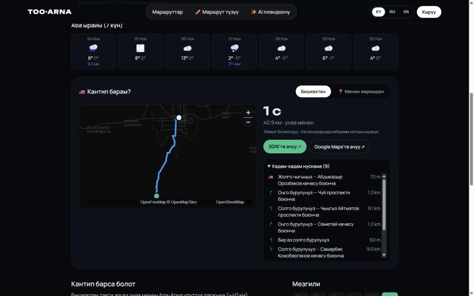
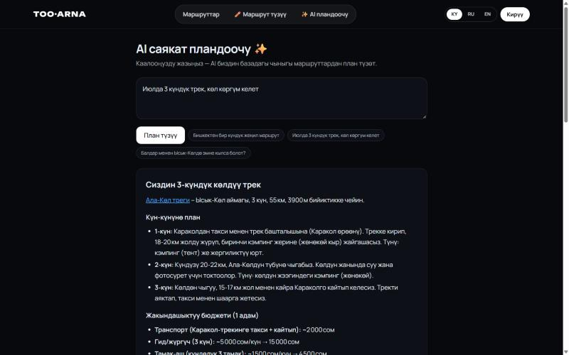

# ⛰️ Too Arna — Кыргызстандын тоо маршруттары

[English](README.en.md) · **Кыргызча**

Кыргызстандагы жөө жүрүш маршруттарынын платформасы: интерактивдүү карта, GPX треги жана бийиктик профили, аба ырайы, сын-пикирлер, офлайн режим, тропалар боюнча **маршрут конструктору**, маршруттун башына чейин **унаа жолу** жана биздин маалымат базасынан гана план түзгөн **AI саякат пландоочу**.



**Стек:** Django 5 · GeoDjango · Django Ninja · PostgreSQL + PostGIS · Next.js 16 (App Router, Server Actions) · MapLibre GL · Tailwind 4 · PWA · Docker · GitHub Actions

## Мүмкүнчүлүктөр

| | |
|---|---|
| 🗺️ **Каталог жана карта** | Облус, татаалдык, ай, узактык боюнча фильтрлер, рейтинг боюнча иреттөө, «мага жакын» (PostGIS `dwithin` + `Distance`) |
| 📈 **GPX** | 10 маршруттун баарында трек жана бийиктик профили бар: `build_tracks` командасы таяныч чекиттерди BRouter аркылуу OSM тропалары боюнча түшүрүп, GPX файлдарын `fixtures/gpx/` папкасына жазат, ал эми `seed_trails` аларды базага жүктөйт. Админкада же API аркылуу да GPX жүктөлөт: маршрут, аралык, бийиктикке көтөрүлүү (hysteresis менен ызы-чуу чыпкаланат) жана бийиктик профили автоматтык түрдө эсептелет |
| 🌦️ **Аба ырайы** | Маршрут башталган жер үчүн Open-Meteo'дон 7 күндүк болжол (кэш менен) |
| ⭐ **Коомчулук** | Катталуу/кирүү (bearer token, httpOnly cookie), сын-пикирлер (бир колдонуучуга бир сын-пикир), тандалгандар |
| 🌗 **Эки тема** | Караңгы («кино») жана ачык тема: бир баскыч менен заматта алмашат, тандоо cookie'де сакталат (сервер туура теманы берет, жылт этүү жок). Карталар да стилин алмаштырат |
| 🌐 **3 тил** | Кыргызча, орусча, англисче: интерфейс да, маршруттардын мазмуну да |
| ✨ **AI пландоочу** | LLM агенти tool calling аркылуу (`search_trails`, `get_trail_details`, `get_weather_forecast`) **чыныгы базадан** гана маршрут сунуштайт, ойдон чыгарбайт. Каалаган OpenAI-шайкеш API менен иштейт (Groq, Gemini, Ollama…). Демейки жөндөө: Groq + `openai/gpt-oss-120b` |
| ✏️ **Маршрут конструктору** | Картаны басып өз маршрутуңузду сызасыз. **«Жол менен»** режиминде ар бир бөлүк OpenStreetMap тропалары боюнча [BRouter](https://brouter.de) (`hiking-mountain` профили) аркылуу түшөт; жакын жерде тропа жок болсо, түз сызыкка өтөт жана колдонуучуга айтат. Аралык, көтөрүлүү/түшүү (DEM ызы-чуусу тегизделет), жүрүү убактысы жана бийиктик профили ошол замат эсептелет. GPX жүктөө, аккаунтка сактоо |
| 🚗 **Кантип барам?** | Бишкектен же колдонуучунун жайгашкан жеринен маршруттун башына чейинки унаа жолу ([OSRM](https://project-osrm.org), FOSSGIS сервери): карта, аралык, убакыт, 3 тилде кадам-кадам нускама, **2GIS / Google Maps'те ачуу** баскычтары |
| 📴 **Офлайн (PWA)** | Service worker: «Офлайн сактоо» баскычы маршруттун барагын жана анын айланасындагы карта плиткаларын (z8–14) кэштейт, анткени тоодо байланыш жок |

## Скриншоттор

| | |
|---|---|
|  |  |
| **Каталог:** фильтрлер, караңгы карта, карточкалар | **Конструктор:** Ала-Арча капчыгайындагы тропа боюнча маршрут |
|  |  |
| **Кантип барам?** Бишкектен унаа жолу жана нускама | **AI пландоочу:** базадагы маршруттардан гана план |

## Иштетүү

```bash
cp .env.example .env      # AI пландоочу үчүн LLM_API_KEY толтуруңуз (Groq же Gemini, акысыз план бар)
docker compose up --build
```

**Windows'то** терминалсыз эле иштетсе болот:

| Файл | Эмне кылат |
|---|---|
| `start.bat` | `.env` түзөт, Docker Desktop'ту ачат жана `docker compose up --build` иштетет |
| `restart.bat` | `.env` өзгөргөндөн кийин контейнерлерди жаңы жөндөөлөр менен кайра ишке киргизет |
| `rebuild-frontend.bat` | Frontend кодун өзгөрткөндөн кийин аны кайра build кылат |

> Башка долбоордун PostgreSQL'и 5432-портту ээлеп турса, `db` контейнери тармакка туташпай калат. Ошол контейнерди токтотуңуз (`docker stop <name>`) же `docker-compose.yml`'деги портту өзгөртүңүз.

- Сайт: http://localhost:3000
- API (Swagger): http://localhost:8000/api/docs
- Админка: http://localhost:8000/admin. Адегенде админ түзүңүз:
  `docker compose exec backend python manage.py createsuperuser`

Backend ар бир жолу ачылганда миграцияларды иштетип, 10 маршрутту базага жүктөйт. Бар маршруттар өзгөртүлбөйт; кайра жазуу керек болсо, `seed_trails --force` колдонуңуз.

### GPX кошуу

Seed маршруттардын тректерин кайра түзүү (таяныч чекиттер `trails.json`'догу `waypoints` талаасында):
`docker compose exec backend python manage.py build_tracks` → `seed_trails --force`

Өз GPX'иңизди кошуу:

1. Админкада маршрутту ачып, **GPX file** талаасына файлды жүктөңүз, же
2. `docker compose exec backend python manage.py import_gpx ala-archa-ratsek /app/track.gpx`

> PWA жана service worker production build'де гана иштейт (`docker compose`'тогу frontend production режиминде иштейт). `npm run dev` режиминде өчүк.

## Тесттер

```bash
docker compose exec backend pytest        # API, auth, сын-пикирлер, GPX, AI агент, конструктор, унаа жолу (тышкы API'лер mock менен)
cd frontend && npx tsc --noEmit && npm run build
```

GitHub'га push кылганда `.github/workflows/ci.yml` экөөнү тең PostGIS менен иштетет.

## API

| Метод | Жол | |
|---|---|---|
| GET | `/api/trails` | `q, region, difficulty[], max_distance_km, max_days, month, lat, lng, radius_km, sort, lang` |
| GET | `/api/trails/{slug}` | Толук маалымат + маршрут + бийиктик профили |
| GET | `/api/trails/{slug}/weather` | 7 күндүк болжол |
| GET | `/api/trails/{slug}/directions` | Унаа жолу: `from_lat, from_lng` (демейки: Бишкек) |
| POST | `/api/routes/analyze` | Конструктор: `{points: [[lng, lat]…], follow_trails}` → аралык, көтөрүлүү, убакыт, профиль, path |
| GET/POST | `/api/me/routes` | Сакталган маршруттар (DELETE `/api/me/routes/{id}`) |
| POST | `/api/trails/{slug}/gpx` | GPX жүктөө (staff гана) |
| GET/POST | `/api/trails/{slug}/reviews` | Сын-пикирлер (POST: кайра жөнөтүлсө, жаңыртылат) |
| DELETE | `/api/reviews/{id}` | Өз сын-пикирин өчүрүү |
| POST | `/api/trails/{slug}/favorite` | Тандалгандарга кошуу/алуу |
| GET | `/api/me/favorites` | Тандалгандар |
| POST | `/api/planner` | AI план `{prompt, lang}` (IP боюнча саатына 15 суроо) |
| POST | `/api/auth/register` · `/login` · `/logout`, GET `/me` | Bearer token |

## Түзүлүшү

```
backend/
  config/                 settings, root NinjaAPI
  accounts/               AuthToken, register/login/me/logout
  trails/
    models.py             Trail (PostGIS), TrailTranslation, Review, Favorite, UserRoute
    routers/              trails, community, planner, routes
    services/
      gpx.py              таза Python: GPX → координаттар, аралык, көтөрүлүү, профиль
      planner.py          AI агенттин цикли (провайдерге көз каранды эмес, тестке ыңгайлуу)
      route_builder.py    конструктор: BRouter тропалары, Open-Meteo DEM, тегиздөө, убакыт
      directions.py       OSRM унаа жолу + кадамдарды жөнөкөйлөтүү
      weather.py          Open-Meteo + кэш
    tests/                pytest (API, GPX, агент, конструктор, унаа жолу)
frontend/
  app/                    беттер + actions.ts (Server Actions: auth, сын-пикир, тандалган, план)
  components/             TrailMap, RouteBuilder, DrivingDirections, ElevationProfile, Weather, Reviews, PlannerForm…
  lib/                    api.ts, i18n.ts (ky/ru/en), session.ts
  public/sw.js            service worker
```

## Архитектура боюнча чечимдер

- **Бардык API чакыруулары сервер тарабында жасалат** (Server Components/Actions). Токен httpOnly cookie'де сакталат, браузердеги JS аны көрбөйт.
- **AI маршрутту ойдон чыгарбайт:** агент маалыматты куралдар аркылуу гана алат, ал эми жоопто шилтеме берилген маршруттар гана `trail_slugs` катары кайтарылат.
- **Рейтинг subquery менен эсептелет** (JOIN менен эмес), ошондуктан текст боюнча издөө орточо бааны бузбайт.
- **GPX логикасы Django'дон бөлүнгөн**, ошондуктан аны база жок эле тестирлесе болот.
- **Тышкы акысыз API'лерди үнөмдөө:** Open-Meteo бийиктик лимитин координат саны боюнча эсептейт, ошондуктан бийиктик ар бир чекит үчүн өзүнчө, BRouter жолу ар бир бөлүк үчүн өзүнчө кэштелет. Жаңы чекит кошулганда жаңы бөлүк гана суралат.
- **Унаа нускамасы маалымат катары кайтарылат** (`type`, `modifier`, көчөнүн аты), ал эми текст frontend'де колдонуучунун тилинде түзүлөт.

## Production (бекер)

| Бөлүк | Кызмат | Эмне үчүн |
|---|---|---|
| База | **Neon** (Франкфурт) | Бекер планы мөөнөтсүз, PostGIS бар. Render'дин бекер базасы 30 күндөн кийин өчөт |
| Backend | **Render** web service (Docker, Франкфурт) | `render.yaml` Blueprint даяр; `/api/health` — базага тийбеген health check |
| Frontend | **Vercel** (`frontend/` папкасы, `fra1` аймагы) | Next.js үчүн эң ылайыктуу |

1. Neon'до долбоор ачып, туташуу дарегин көчүрүңүз (`postgresql://…?sslmode=require`).
2. Render → **New → Blueprint** → бул репо. `DATABASE_URL` жана `LLM_API_KEY` маанилерин киргизиңиз. Backend биринчи ачылганда миграцияларды иштетип, маршруттарды жана тректерди өзү жүктөйт.
3. Vercel → **Add New → Project** → бул репо, Root Directory: `frontend`, `API_URL` = Render'дин дареги.
4. Render'де `CORS_ALLOWED_ORIGINS` = Vercel'дин дареги.
5. Админка (`https://<render-дарек>/admin`): Render'дин бекер планында Shell жок, ошондуктан `DJANGO_SUPERUSER_USERNAME`, `DJANGO_SUPERUSER_EMAIL`, `DJANGO_SUPERUSER_PASSWORD` өзгөрмөлөрүн коюңуз: backend ачылганда админ аккаунтун өзү түзөт.
6. (Милдеттүү эмес) GitHub → Settings → Variables → `BACKEND_URL` = Render'дин дареги: `keepalive.yml` backend'ди ар 10 мүнөттө "ойготуп" турат, ошондо биринчи кирүү 1 мүнөт күтпөйт.

## ⚠️ Маалыматтар тууралуу

Seed'деги координаттар, аралыктар жана бийиктиктер **болжолдуу**. Коомчулукка чыгараардан мурда ар бир маршрутту чыныгы GPX трек менен текшериңиз.

## Сүрөттөр

Бардык сүрөттөр [Unsplash](https://unsplash.com) лицензиясы менен колдонулат:

- `hero.jpg` — Amir Asake, «Mountains of North Kyrgyzstan»
- `lake.jpg` — Ilya Yudin
- `valley.jpg` — Denis Volkov
- `hills.jpg` — Bakhtiyar Ibragimov

---
Карта: [OpenFreeMap](https://openfreemap.org) · © OpenStreetMap contributors · Рельеф: Mapzen Terrain Tiles (AWS Open Data) · Аба ырайы жана бийиктик: [Open-Meteo](https://open-meteo.com) · Тропалар: [BRouter](https://brouter.de) · Унаа жолу: [OSRM](https://project-osrm.org) / FOSSGIS
